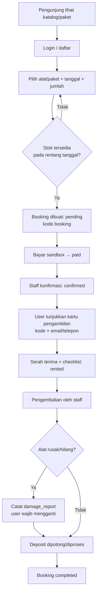
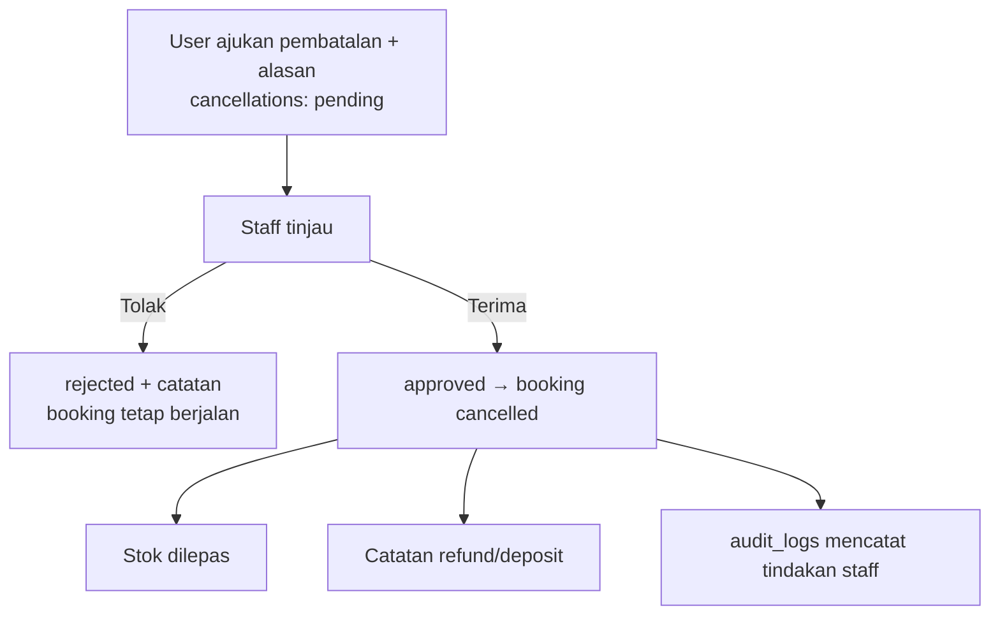
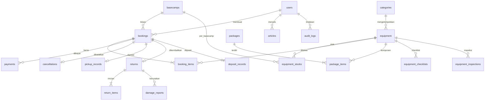

# Dokumentasi CampRent — Aplikasi Reservasi Persewaan Alat Camping

Kelas A • PHP Native + MySQL • Tailwind CSS (CDN) • Desain: Google Stitch

## 1. Jobdesk anggota
Lihat `docs/PEMBAGIAN-KERJA.md` (Akhilla: Frontend User, Natasya: Frontend Staff & Admin, Difa: Backend User & inti reservasi, Ani: Backend Staff & Admin).

## 2. Peran & hak akses
| Fitur | Pengunjung | User | Staff | Admin |
|---|:-:|:-:|:-:|:-:|
| Beranda, katalog, artikel | ✓ | ✓ | ✓ | ✓ |
| Booking, riwayat, batal, profil | – | ✓ | – | – |
| Dashboard, reservasi, pembatalan, pengembalian | – | – | ✓ | ✓ |
| CRUD alat/kategori/stok/tarif/artikel, laporan | – | – | ✓ | ✓ |
| Manajemen akun, log tindakan staff | – | – | – | ✓ |

## 3. Alur bisnis
### 3.1 Reservasi sampai pengembalian

### 3.2 Pembatalan

### 3.3 Validasi stok
Stok tersedia = `total_units − unavailable_units − unit yang ditahan booking berstatus pending/confirmed/rented yang tanggalnya beririsan`. Paket diurai menjadi alat penyusunnya (`package_items`). Maks 14 hari per booking.

## 4. ERD (ringkas, dari `database/camprent_recovery.sql`)

## 5. Keamanan
Hash password (`password_hash`/bcrypt), prepared statement PDO, token CSRF di semua form POST, escape output `e()`, proteksi rute per peran (`require_login()`, `require_role()`), regenerasi sesi saat login, pembatas percobaan login, cookie sesi HttpOnly + SameSite.

## 6. Menjalankan & akun demo
Lihat `README.md`. Akun: admin@demo.test / Admin#2026, staff@demo.test / Staff#2026, user@demo.test / User#2026.

## 7. Struktur & panduan kontribusi
Lihat `README.md` (struktur folder) dan `docs/PANDUAN-TIM.md` (alur Git).
